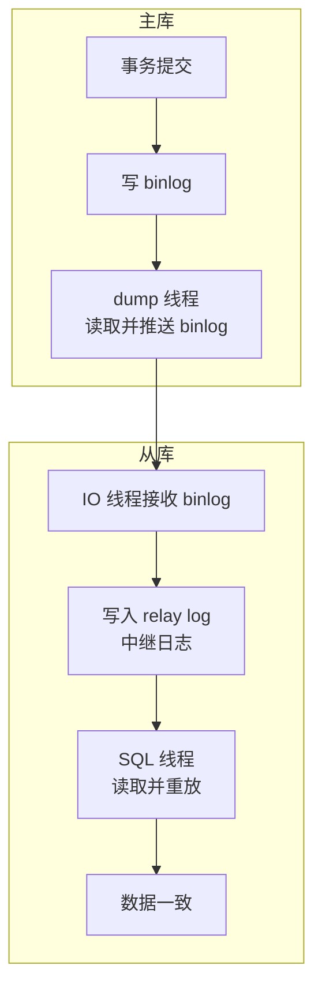

# 高可用


## 主从复制的原理？

### 复制流程（三线程）



| 线程 | 所在 | 职责 |
|------|------|------|
| dump 线程 | 主库 | 从 binlog 读取并推送给从库 |
| IO 线程 | 从库 | 接收 binlog，写入 relay log |
| SQL 线程 | 从库 | 重放 relay log 中的事件 |

搭建：主库建复制账号，从库 `change master to ... ; start slave;`

### 三种复制模式

| 模式 | 流程 | 一致性 | 性能 |
|------|------|--------|------|
| 异步（默认） | 主库提交即返回，不等从库 | 崩溃可能丢数据 | 高 |
| 半同步 | ≥1 个从库**收到 binlog**（不是执行完）才返回 | 降级为异步可配 | 中 |
| 全同步 | 所有从库执行完才返回 | 最强 | 差，少用 |

> [!NOTE]
> 配置半同步和全同步需要使用插件

### 主从延迟

**原因**：SQL 线程单线程重放（早期）赶不上主库并发写入；大事务、从库机器差、从库承担大量读。

**危害**：写后立即读从库读不到（"刚下单查不到订单"）。

**缓解**：

1. 半同步 + 合理降级策略
2. 5.7+ 并行复制（MTS，按组/WRITESET 并行重放）
3. 大事务拆小，避免单条 binlog 过大
4. 关键读强制走主库（写后一段时间内、或关键业务）
5. 中间件路由：ShardingSphere / ProxySQL 的强制主读

### 延迟排查

```sql
show slave status\\G
-- Seconds_Behind_Master：延迟秒数
-- Slave_IO_Running / Slave_SQL_Running：两个线程是否正常
```


## 分库分表怎么做？

### 什么时候拆

- 单表：MySQL 建议 2000 万行 / 20GB 内（B+ 树 3 层的量级）
- 单库：连接数 / CPU / IO 到瓶颈
- 拆之前先确认：索引优化、SQL 优化、读写分离、归档冷数据都做了吗？

### 拆分方式

| 方式 | 说明 | 示例 |
|------|------|------|
| **垂直分库** | 按业务域拆库 | 订单库、用户库、商品库 |
| **垂直分表** | 按列拆：冷热/大小分离 | 主表（常用列）+ 详情表（大字段） |
| **水平分库** | 同构库，行数据分散到多库 | user_db_0 / user_db_1 |
| **水平分表** | 同库内按行拆多表 | order_0 ~ order_7 |

### 分片策略

| 策略 | 做法 | 优缺点 |
|------|------|--------|
| **hash 取模** | `分片 = shard_key % N` | 均匀；**扩容要迁移数据** |
| **range 范围** | 按时间/ID 段分（1-100万→表1） | 扩容容易；**热点集中**（新表压力最大） |
| **基因法** | 把分片基因嵌入 ID（如订单号尾号带用户 ID 基因） | 用订单号也能定位到用户所在分片，免全路由 |
| **查找表** | 单独维护 key→分片映射 | 灵活；多一跳查询 |

```java
// 典型：订单按 user_id 分 8 库 8 表
int dbIndex  = userId.hashCode() % 8;
int tblIndex = (userId / 8) % 8;   // 避免库表同余导致数据倾斜
```

### 分布式 ID

自增 ID 跨库会重复，替换方案：

| 方案 | 特点 |
|------|------|
| **雪花算法** | 时间戳+机器+序列，趋势递增（注意时钟回拨） |
| 号段模式（Leaf） | DB 批量发号段，内存分配 |
| UUID | 无序（B+ 树页分裂）、太长，索引不友好 |

### 扩容（hash 分片痛点）

双写迁移：


另一路线：一开始就 32/64 库拆到位，按 2^n 扩容每次只迁移一半数据。

### 拆分后的问题

| 问题 | 方案 |
|------|------|
| 跨库 join | 冗余字段 / 应用层组装 / 数据异构 ES |
| 跨库事务 | 最终一致（本地消息表 + MQ）、Seata、TCC |
| 跨库分页 | 各分片取 top N 归并；或用 ES/宽表承接复杂查询 |
| 非分片键查询 | 基因法 / 全路由广播（慢）/ 异构索引表 |


> [!CAUTION]
> 分库分表使用中间件：ShardingSphere-JDBC（客户端层）、MyCat（代理层）


## 什么是 ShardingSphere-JDBC？

Apache ShardingSphere 的**客户端分片组件**：一个增强版 JDBC 驱动 jar，应用引入后，分库分表的路由、SQL 改写、结果归并都在**应用进程内**完成，数据库和应用都无需额外部署组件。

### 核心功能

| 功能 | 说明 |
|------|------|
| 数据分片 | 分库分表 + 读写分离，支持 inline / hash / range 等算法 |
| 分布式主键 | 内置雪花算法，替代数据库自增 |
| 数据加密 | 字段透明加解密 |
| 影子库 | 压测流量隔离到影子库 |
| 分布式事务 | XA（强一致）/ BASE（Seata 最终一致） |

### 配置示例（5.x Spring Boot 节选）

```yaml
rules:
  sharding:
    tables:
      t_order:
        actual-data-nodes: ds$->{0..1}.t_order_$->{0..7}    # 真实数据节点
        database-strategy:
          standard:
            sharding-column: user_id                        # 分片键
            sharding-algorithm-name: db-mod
    sharding-algorithms:
      db-mod:
        type: INLINE
        props:
          algorithm-expression: ds$->{user_id % 2}          # 分片表达式
```

### 注意

- 跨库 join / 深分页 / 复杂聚合能力有限，复杂查询异构到 ES
- 跨库事务按业务选：强一致 XA（性能差）或最终一致 BASE
- 只支持 Java；异构语言用 ShardingSphere-Proxy
