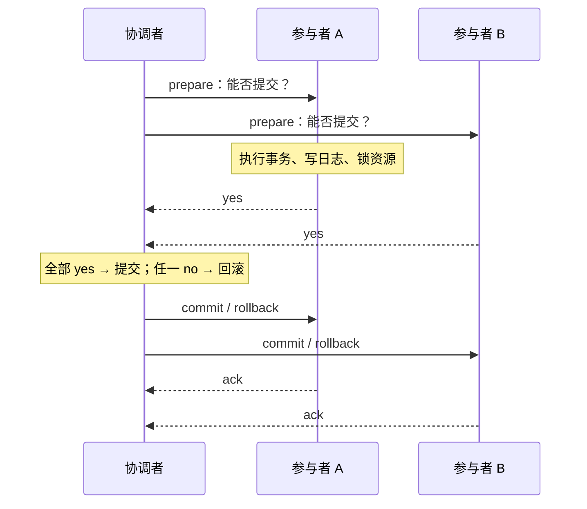

# 事务


## 事务的 ACID 特性及实现原理？

| 特性 | 含义 | 实现手段 |
|------|------|----------|
| **A 原子性** | 全部成功或全部回滚 | **undo log**：记录反向操作，回滚时逆序执行 |
| **C 一致性** | 从一个合法状态到另一个合法状态 | 由 A + I + D 共同保证，是最终目的 |
| **I 隔离性** | 事务之间互不干扰 | **MVCC + 锁**：写写靠锁，读写靠 MVCC |
| **D 持久性** | 提交后永久生效 | **redo log**：先写日志刷盘，崩溃后重放恢复 |

### 原子性：undo log

```
insert 10 → undo 记录 delete 10
update a=1→2 → undo 记录 update a=2→1
回滚 = 从 undo log 逆序执行反向操作
```

### 持久性：redo log（WAL）

```
修改数据 → 先写 redo log（顺序 IO，快）→ 再择机刷数据页（随机 IO，慢）
崩溃恢复：重放 redo log，把未落盘的修改补齐
```

- WAL（Write-Ahead Logging）：日志先于数据页落盘
- `innodb_flush_log_at_trx_commit=1`：每次提交都 fsync，最安全

### 隔离性：锁 + MVCC

- 写-写冲突：行锁（排他）
- 读-写冲突：MVCC 让读不加锁（详见 MVCC 题）

### 一致性：结果而非手段

C 是目的，A/I/D 是手段；加上数据库约束（主键、唯一、外键）与应用层校验共同保证。


## 事务的隔离级别有哪些？

### 三类并发问题

| 问题 | 描述 | 示例 |
|------|------|------|
| **脏读** | 读到别的事务**未提交**的数据，对方回滚后读到的是脏数据 | A 改余额未提交，B 读到新值 |
| **不可重复读** | 同一事务内两次**读同一行**结果不同（别人 update 并提交了） | A 两次读余额，中间 B 转走 100 |
| **幻读** | 同一事务内两次**范围查询**行数不同（别人 insert 并提交了） | A 两次 count，中间 B 插入一行 |

不可重复读侧重**行内容变了**（update），幻读侧重**行数变了**（insert/delete）。

### 四个隔离级别

| 级别 | 脏读 | 不可重复读 | 幻读 | 说明 |
|------|------|------------|------|------|
| 读未提交（RU） | ❌ 会发生 | ❌ | ❌ | 性能最好，几乎不用 |
| 读已提交（RC） | ✅ 避免 | ❌ | ❌ | Oracle/PG 默认 |
| **可重复读（RR）** | ✅ | ✅ | ✅* | **InnoDB 默认** |
| 串行化 | ✅ | ✅ | ✅ | 读加共享锁，并发最差 |


```sql
-- 查看/设置
select @@transaction_isolation;
set session transaction isolation level read committed;
```


## MVCC 的实现原理？

MVCC（多版本并发控制）：读操作**不加锁**，通过数据的历史版本快照实现读写不阻塞，是 RC/RR 隔离级别的实现基础。

### 三大组件

#### 1. 隐藏列

每行数据两个隐藏列：

```
trx_id：最近修改它的事务 ID
roll_pointer：指向 undo log 中的上一版本
```

#### 2. undo log 版本链

```
当前行 (name='c', trx_id=300)
   ↑ roll_pointer
版本2 (name='b', trx_id=200)
   ↑
版本1 (name='a', trx_id=100)
```

一行数据的所有历史版本通过 roll_pointer 串成链，需要旧版本时沿链找。

#### 3. ReadView（快照）

事务执行快照读时生成，包含四个字段：

| 字段 | 含义                             |
|------|----------------------------------|
| m_ids | 生成时活跃（未提交）事务 ID 集合 |
| min_trx_id | m_ids 中最小值                   |
| max_trx_id | 系统下一个将分配的事务 ID        |
| creator_trx_id | 当前事务自己的 ID                |

### 可见性判断规则

对版本链上某一版本的 trx_id：

```
trx_id == creator_trx_id      → 自己改的，可见 ✅
trx_id < min_trx_id           → 生成快照前已提交，可见 ✅
trx_id >= max_trx_id          → 快照后才开启的事务，不可见 ❌
min_trx_id <= trx_id < max_trx_id
    在 m_ids 中               → 当时还活跃未提交，不可见 ❌
    不在 m_ids                → 快照前已提交，可见 ✅

不可见 → 沿 roll_pointer 找上一版本，重复判断，直到找到可见版本
```

### 快照读 vs 当前读

| 类型 | 说明 | SQL |
|------|------|-----|
| **快照读** | 读 MVCC 快照，不加锁 | 普通 `select` |
| **当前读** | 读最新已提交版本，加锁 | `select ... for update`、`select ... lock in share mode`、`update`、`delete`、`insert` |

### RC 与 RR 的本质区别

| 级别 | ReadView 生成时机 | 效果 |
|------|-------------------|------|
| RC | **每条** select 都生成新的 | 能看到别的事务最新提交 → 不可重复读 |
| RR | 事务**第一条** select 生成，全程复用 | 只能看到事务开始前提交的数据 → 可重复读 |


## 什么是两阶段提交（2PC）？有什么问题？

单库事务靠本地 undo/redo 就能保证原子性；**跨库/跨服务**后，需要一个**协调者**让所有参与者要么全提交、要么全回滚。2PC 是最朴素的强一致方案。

### 流程



- **阶段一（投票）**：参与者执行事务但不提交，写好 undo/redo、锁定资源，回答 yes/no
- **阶段二（执行）**：全部 yes 则协调者发 commit，参与者正式提交并释放资源；任一 no 则全部回滚

### 问题

| 问题 | 说明 |
|------|------|
| **同步阻塞** | prepare 到 commit 之间，参与者锁着资源干等，并发吞吐骤降 |
| **协调者单点** | 协调者在阶段二前挂掉，参与者既不敢提交也不敢回滚，资源永久锁死 |
| **数据不一致** | 阶段二的消息部分送达（网络分区），有的提交了有的没有 |
| **性能差** | 两轮 RPC + 长时间持锁，互联网高并发场景基本不可用 |

3PC 加入 CanCommit/PreCommit/DoCommit 三阶段与超时机制，缓解阻塞与单点，但仍无法根除不一致且更慢，实际很少使用。

### 实际怎么做

- 数据库层 XA 事务（MySQL XA、Spring JTA）就是 2PC，强一致但性能差，小规模内部系统可用
- 互联网主流是**放弃强一致、换最终一致**：本地消息表 + MQ、RocketMQ 事务消息、TCC、Seata AT

一句话：**2PC 用阻塞和单点换强一致，高并发下代价太大，所以实际多用最终一致方案**。
