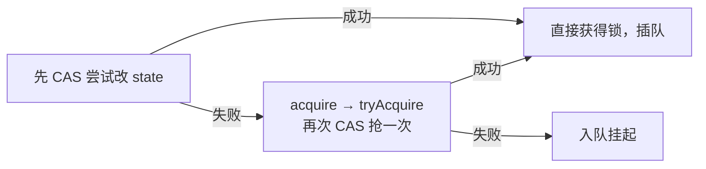
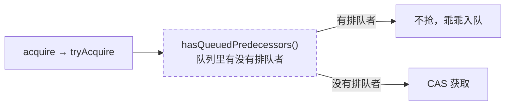

# 锁


## 悲观锁和乐观锁

两种并发控制的思想，区别在于**对冲突发生概率的假设**。

### 悲观锁

- **假设冲突经常发生**，操作前先加锁，独占资源
- 其他线程必须等待锁释放才能操作

```java
synchronized (lock) {
    count++;   // 独占执行，其他线程阻塞
}
```

Java 中的实现：

| 实现 | 说明 |
|------|------|
| `synchronized` | JVM 内置锁（monitor） |
| `ReentrantLock` | JUC 显式锁，支持公平/非公平、可中断、超时 |
| 数据库行锁 / `select for update` | 数据库层面的悲观锁 |

### 乐观锁

- **假设冲突很少发生**，不加锁直接操作，提交时校验是否被改过
- 冲突则重试或失败，适用于读多写少

```java
// CAS：Compare And Swap
AtomicInteger count = new AtomicInteger();
count.incrementAndGet();  // 底层 CAS，失败自旋重试
```

Java 中的实现：

| 实现 | 说明 |
|------|------|
| `Atomic` 系列 | 基于 CAS（`lock cmpxchg`） |
| `LongAdder` | CAS + 分散热点 |
| 版本号机制 | 数据库乐观锁：`update set x=?, version=version+1 where version=?` |

### 对比

| 对比项 | 悲观锁 | 乐观锁 |
|--------|--------|--------|
| 假设 | 冲突频繁 | 冲突很少 |
| 策略 | 先加锁再操作 | 先操作提交时校验 |
| 阻塞 | 阻塞其他线程 | 不阻塞，失败重试 |
| 性能（低冲突） | 有锁开销，稍差 | 好 |
| 性能（高冲突） | 稳定 | 自旋浪费 CPU，急剧下降 |
| 适用 | 写多、临界区复杂 | 读多写少、冲突率低 |

### CAS 原理

```
CAS(内存地址 V, 预期值 A, 新值 B)
  当 V == A 时，把 V 更新为 B，返回成功
  否则什么都不做，返回失败
```

- 由 CPU 一条指令（x86 `lock cmpxchg`）保证原子性
- Java 通过 `Unsafe.compareAndSwapInt` 等 native 方法调用
- `AtomicInteger.incrementAndGet()` = 自旋 + CAS

**CAS 三大问题**：

| 问题 | 说明 | 解决 |
|------|------|------|
| ABA 问题 | 值从 A 改成 B 又改回 A，CAS 感知不到 | `AtomicStampedReference` 加版本号 |
| 自旋开销 | 高冲突下反复失败重试，空耗 CPU | 限次重试、`LongAdder` 分散热点 |
| 只能保证单变量 | 多个变量的复合操作无法一次 CAS | `AtomicReference` 包对象，或加锁 |

### 数据库场景

```sql
-- 悲观锁：先锁行再操作
select * from account where id = 1 for update;
update account set balance = balance - 100 where id = 1;

-- 乐观锁：版本号
update account set balance = balance - 100, version = version + 1
where id = 1 and version = #{oldVersion};
-- 影响行数为 0 说明被改过，重试或报错
```


## synchronized 的锁升级过程？

JDK 6 优化了 synchronized：锁并非一开始就是重量级，而是随竞争加剧逐级膨胀。**无锁 → 偏向锁 → 轻量级锁 → 重量级锁**，只能升级不能降级。

### 对象头 Mark Word

锁状态记录在对象头 Mark Word 中：

| 锁状态 | 标志位 | Mark Word 存的内容 |
|--------|--------|---------------------|
| 无锁 | 01 | 对象 hashCode、GC 分代年龄 |
| 偏向锁 | 01（偏向位=1） | 偏向的线程 ID |
| 轻量级锁 | 00 | 指向栈中 Lock Record 的指针 |
| 重量级锁 | 10 | 指向 monitor（互斥量）的指针 |
| GC 标记 | 11 | 空 |

### 偏向锁

- **场景**：锁始终只被一个线程访问，无竞争
- **原理**：第一次获取时 CAS 把线程 ID 写入 Mark Word，之后该线程进入同步块**无需任何同步操作**（连 CAS 都省了）
- 其他线程来竞争时，偏向锁撤销（等到全局安全点），升级为轻量级锁
- 参数：`-XX:+UseBiasedLocking`（JDK 15 前默认开启）

::: danger
JDK 15 起默认禁用（JEP 374）：维护成本高、现代应用多为多线程交替，收益小
:::

### 轻量级锁

- **场景**：多个线程**交替**执行同步块，竞争不激烈
- **原理**：
  1. 线程栈帧中创建 Lock Record，拷贝 Mark Word（Displaced Mark Word）
  2. CAS 将对象头指向 Lock Record
  3. 成功 → 获得轻量级锁；失败 → 自旋重试
- 自旋一定次数仍失败，膨胀为重量级锁
- 优点：避免线程阻塞挂起（用户态完成）；缺点：自旋空耗 CPU

### 重量级锁

- **场景**：多线程同时竞争，自旋无法解决
- **原理**：对象头指向 monitor（ObjectMonitor），依赖操作系统的 **mutex（互斥量）** 实现
- 未抢到锁的线程**阻塞挂起**（内核态），涉及用户态/内核态切换，开销大
- 锁释放后唤醒阻塞线程

### 升级流程


- 升级是**单向**的，不能降级（避免降级时的混乱和开销）
- 目的：绝大多数锁从头到尾没有竞争，用最轻的方案处理

### 其他锁优化

| 优化 | 说明 |
|------|------|
| **自适应自旋** | 自旋次数由 JVM 根据该锁历史上的自旋结果动态调整（上次自旋成功则允许更长自旋） |
| **锁消除** | JIT 通过逃逸分析发现锁对象不可能被共享，直接删掉锁（如方法内局部的 StringBuffer） |
| **锁粗化** | 循环内反复加锁解锁，JIT 合并为一次加锁（扩大锁范围） |

```java
// 锁消除：sb 不逃逸，synchronized 会被 JIT 删掉
public String concat(String a, String b) {
    StringBuffer sb = new StringBuffer();  // StringBuffer 方法都是 synchronized
    sb.append(a);
    sb.append(b);
    return sb.toString();
}

// 锁粗化：循环内 append 反复锁解锁，被合并为整段一次锁
for (int i = 0; i < 100; i++) {
    sb.append(i);
}
```


## 谈谈 ReentrantLock

`ReentrantLock` 是 JUC 提供的**可重入互斥锁**，基于 AQS 实现，功能比 synchronized 丰富，需要手动加锁解锁。

### 基本用法

```java
private final ReentrantLock lock = new ReentrantLock();  // 默认非公平

public void doSomething() {
    lock.lock();                 // 加锁
    try {
        // 临界区
    } finally {
        lock.unlock();           // 必须在 finally 中解锁
    }
}
```

- 模板固定：`lock()` 后紧跟 `try-finally`，保证异常时也能解锁
- 忘记 `unlock()` 会导致锁永远不释放

### 核心特性

| 特性 | API | synchronized 是否具备 |
|------|-----|------------------------|
| 可重入 | 同一线程可重复 lock（state 计数） | ✅ |
| 公平锁 | `new ReentrantLock(true)`，按排队顺序获取 | ❌（只有非公平） |
| 尝试获取 | `tryLock()`：拿不到立即返回 false | ❌ |
| 超时获取 | `tryLock(3, TimeUnit.SECONDS)` | ❌ |
| 可中断 | `lockInterruptibly()`：等待时响应中断 | ❌ |
| 多条件变量 | `Condition`（多个等待队列） | ❌（一个对象一个等待集） |

```java
// Condition：一把锁多个等待条件
private final Condition notFull  = lock.newCondition();
private final Condition notEmpty = lock.newCondition();
// 经典应用：ArrayBlockingQueue 的生产者-消费者
```

### 公平 vs 非公平

| 对比 | 公平锁 | 非公平锁（默认） |
|------|--------|------------------|
| 获取顺序 | 先到先得（FIFO） | 允许插队，新线程直接抢 |
| 吞吐量 | 低 | 高（减少线程切换） |
| 饥饿 | 不会 | 可能（某线程长期抢不到） |

非公平是新线程先 CAS 试一次，成功了直接插队；失败才排队。synchronized 就是非公平语义。

### 实现原理（AQS）

`ReentrantLock` 基于 **AQS（AbstractQueuedSynchronizer）**：

```
state（volatile int）         → 0 无锁，>0 重入次数
exclusiveOwnerThread          → 持锁线程
CLH 变体双向队列              → 抢锁失败的线程入队挂起（park）
```

- 加锁：CAS 修改 state（0→1），失败入队，`LockSupport.park()` 挂起
- 解锁：state 减到 0，`unpark()` 唤醒队列头部的后继线程
- 公平锁与非公平锁的唯一区别：非公平先 CAS 抢一次，公平直接排队

### 与 synchronized 对比

| 对比项 | synchronized | ReentrantLock |
|--------|--------------|---------------|
| 层面 | JVM 内置（关键字） | JDK 类库（API） |
| 解锁 | 自动（异常也释放） | 手动（必须 finally） |
| 公平锁 | ❌ | ✅ 可选 |
| 可中断/超时/尝试 | ❌ | ✅ |
| 条件变量 | 单一 wait/notify | 多个 Condition |
| 性能 | JDK 6 优化后基本持平 | 基本持平 |
| 锁升级 | 偏向/轻量/重量级 | 无（固定 AQS 逻辑） |
| 使用建议 | 默认首选，简单安全 | 需要高级特性时用 |


## AQS 是什么？

AQS（AbstractQueuedSynchronizer）是 JUC 的**同步器基石**，解决的问题是：**多线程竞争同一资源时，抢不到的线程如何排队、挂起、被唤醒**。ReentrantLock、Semaphore、CountDownLatch、读写锁都基于它实现。

AQS中维护了一个信号量（**state**）和一个双向链表队列，这个队列用于线程的排队，而 state 就是红绿灯，用于控制线程排队和放行

### 独占与共享

AQS 支持两种资源共享方式：

| 模式 | 入口方法 | 语义 | 代表                                                      |
|------|----------|------|-----------------------------------------------------------|
| **独占** | acquire / release | 同一时刻至多一个线程通过 | ReentrantLock、ReentrantReadWriteLock中的写锁             |
| **共享** | acquireShared / releaseShared | 多个线程可同时通过，释放时向后传播唤醒 | Semaphore、ReentrantReadWriteLock中的读锁、CountDownLatch |


### 不同的 state 含义

| 实现类 | 模式 | state 的含义 |
|--------|------|--------------|
| ReentrantLock | 独占 | 0 无锁 / >0 重入次数 |
| ReentrantReadWriteLock | 读共享 + 写独占 | 高 16 位读锁数 / 低 16 位写锁重入 |
| Semaphore | 共享 | 剩余许可数 |
| CountDownLatch | 共享 | 计数值，减到 0 放行 |
| ThreadPoolExecutor 的 Worker | 独占（简化、不可重入） | 0 / 1 |

## 公平锁和非公平锁的区别？

区别在于**锁释放后由谁获得**：按排队顺序给 = 公平；允许后来者插队抢锁 = 非公平。

### 定义

| 类型 | 定义 | 获取顺序 |
|------|------|----------|
| **公平锁** | 严格按请求锁的先后顺序（FIFO）分配 | 排队最久的线程先获得 |
| **非公平锁** | 释放后任意线程（含刚到的）都可直接竞争 | 后来者可能插队 |

```java
new ReentrantLock(true);   // 公平锁
new ReentrantLock(false);  // 非公平锁
new ReentrantLock();       // 默认非公平
```

### 实现差异（AQS 视角）

唯一区别在**加锁入口是否先抢一次**：

**非公平锁 lock()**



**公平锁 lock()**



### 为什么默认非公平？

- **吞吐量高**：锁释放的瞬间，新到的线程直接 CAS 抢到，**不需要唤醒队列线程**（唤醒涉及 park/unpark、内核态切换，耗时）
- 大多数场景线程持锁时间短，插队成功率高，排队线程被唤醒前锁已被用完归还
- 唤醒一个挂起线程的间隙可能造成 CPU 空转，非公平把这段空隙填满

### 非公平的代价

- **饥饿**：极端竞争下，某个线程可能一直抢不过后来者，长期拿不到锁
- 等待时间不可预测

### 对比总结

| 对比项 | 公平锁 | 非公平锁 |
|--------|--------|----------|
| 获取顺序 | FIFO，先到先得 | 可插队 |
| 吞吐量 | 低 | 高 |
| 饥饿 | 不会 | 可能 |
| 唤醒开销 | 每次都要走队列 | 常被插队线程跳过 |
| 实现复杂度 | hasQueuedPredecessors 检查 | 直接 CAS |
| 适用 | 严格顺序、不能饿死 | 绝大多数业务场景 |

### 使用场景

| 场景 | 选择 |
|------|------|
| 一般业务（QPS 统计、缓存、连接池） | 非公平（默认） |
| 严格的顺序性要求、任务不能饿死（如按下单顺序处理） | 公平 |

### 其他锁的公平性

| 锁 | 公平性 |
|-----|--------|
| `synchronized` | 只有非公平，无法选择 |
| `ReentrantLock` | 构造参数可选 |
| `ReentrantReadWriteLock` | 构造参数可选 |
| `Semaphore` / `CountDownLatch` 等基于 AQS 的工具 | 构造参数可选，默认非公平 |


## 排他锁和共享锁的区别？

区别在于**同一时刻能被几个线程持有**：排他锁独占，共享锁可多个线程同时持有。

### 定义

| 类型 | 别名 | 持有方式 | 兼容性 |
|------|------|----------|--------|
| **排他锁**（Exclusive） | 写锁、X 锁 | 同一时刻仅 1 个线程 | 与所有锁互斥 |
| **共享锁**（Shared） | 读锁、S 锁 | 可被多个线程同时持有 | 共享↔共享兼容；共享↔排他互斥 |


### Java 中的实现

#### ReentrantReadWriteLock

读写锁的经典实现，一个 state 按高低位拆成两半：

```
state（32 位 int）
├── 高 16 位：读锁持有数（每个线程可重入，计数累加）
└── 低 16 位：写锁重入次数
```

```java
private final ReentrantReadWriteLock rwLock = new ReentrantReadWriteLock();
private final Lock readLock  = rwLock.readLock();   // 共享
private final Lock writeLock = rwLock.writeLock();  // 排他

// 读：多线程并发进入
readLock.lock();
try { /* 读数据 */ } finally { readLock.unlock(); }

// 写：独占，读写都进不来
writeLock.lock();
try { /* 修改数据 */ } finally { writeLock.unlock(); }
```

特点：

- 读锁、写锁都可重入
- **写锁可降级为读锁**（写→读，先获取写锁再获取读锁再释放写锁）；**读锁不能升级为写锁**（会死锁：多个读线程都想升级，互相等）
- 锁降级是安全的写后读模式，避免改完立刻读时被其他写线程插队

#### 其他共享/排他的 AQS 工具

| 工具 | 模式 |
|------|------|
| `ReentrantLock` / `synchronized` | 纯排他 |
| `ReentrantReadWriteLock` | 读共享 + 写排他 |
| `Semaphore` | 共享（ permits 个） |
| `CountDownLatch` | 共享（count 减到 0 放行） |
| `StampedLock`（JDK 8） | 写排他 + 读共享 + **乐观读** |

#### StampedLock 的优化

- 写锁：排他
- 悲观读锁：共享
- **乐观读**：不加锁读，读前拿 stamp，读后 `validate(stamp)` 检查期间有没有写发生；没有则读有效，有则升级为悲观读锁重读
- 读多写少场景性能远超 ReadWriteLock，但**不可重入、不支持 Condition**

### 数据库场景

| 数据库锁 | 类型 |
|----------|------|
| `select ... for update` | 排他（X 锁，行级） |
| `select ... lock in share mode` | 共享（S 锁，行级） |
| 表级 S 锁 / X 锁 | DDL、全表更新等 |

### 写饥饿问题

读写锁的缺陷：读多写少时，读锁源源不断，**写线程可能长期抢不到锁（饥饿）**。

缓解方案：

- 公平模式的 ReadWriteLock（吞吐下降）
- StampedLock 乐观读（读不加锁，写不再被读阻塞）

## 什么是死锁？如何排查和避免？

死锁：两个或多个线程**互相持有对方需要的锁**，永久阻塞。

### 经典死锁代码

```java
Object lockA = new Object();
Object lockB = new Object();

// 线程1：先拿 A 再拿 B
new Thread(() -> {
    synchronized (lockA) {
        sleep(100);                      // 给线程2时间先拿 B
        synchronized (lockB) { }         // 等 B，但 B 在线程2手里
    }
}).start();

// 线程2：先拿 B 再拿 A → 互相等待，永久卡死
new Thread(() -> {
    synchronized (lockB) {
        sleep(100);
        synchronized (lockA) { }         // 等 A，但 A 在线程1手里
    }
}).start();
```

### 四个必要条件（缺一不可）

| 条件 | 含义 |
|------|------|
| **互斥** | 资源同一时刻只能被一个线程持有 |
| **持有并等待** | 拿着一把锁，再去等另一把 |
| **不可剥夺** | 别人不能强行抢走已持有的锁 |
| **循环等待** | 等待关系形成环（A等B，B等A） |

### 如何排查

```bash
# jstack：直接输出死锁检测
jstack <pid>       # 末尾出现 "Found one Java-level deadlock"

# Arthas
thread -b          # 直接找出阻塞其他线程最多的线程（死锁元凶）
thread --state BLOCKED
```

- 日志表现：接口 hang 死无响应、无异常；线程堆栈显示多个线程都在 `waiting to lock <0x...>`
- 预防线上排查难：开启 `-XX:+HeapDumpOnOutOfMemoryError` 的同时对核心接口做超时控制

### 如何避免（破坏条件）

| 策略 | 破坏条件 | 做法 |
|------|----------|------|
| **锁排序** | 循环等待 | 所有线程按统一顺序加锁（先 A 后 B） |
| **tryLock 超时** | 不可剥夺 | `lock.tryLock(1, TimeUnit.SECONDS)` 拿不到就放弃已有锁，退避后重试 |
| **一次性申请** | 持有并等待 | 开始前把所有资源一次拿齐 |
| **减小锁粒度** | 互斥时间 | 临界区尽量小、耗时操作移出锁外 |
| **无锁化** | 互斥 | CAS / 单线程化（消息队列串行） |

```java
// tryLock 退避示例
while (true) {
    if (lockA.tryLock(1, TimeUnit.SECONDS)) {
        try {
            if (lockB.tryLock(1, TimeUnit.SECONDS)) {
                try { /* 干活 */ return; }
                finally { lockB.unlock(); }
            }
        } finally { lockA.unlock(); }
    }
    sleep(random);   // 随机退避，避免活锁
}
```