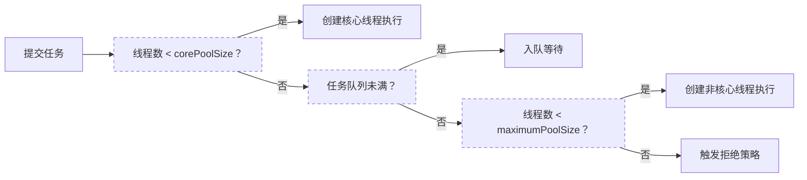
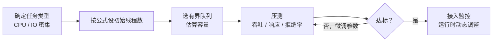
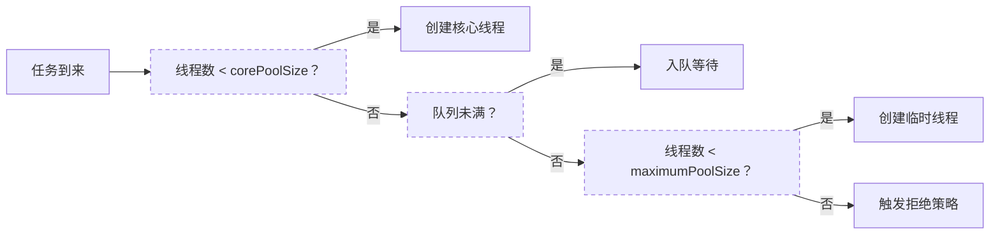

# 线程池


## 线程池有哪些？

`Executors` 工具类提供了几种预置线程池，实际生产中推荐用 `ThreadPoolExecutor` 自定义。

### 预置线程池

| 线程池 | 特点                                                               | 适用场景 |
|--------|--------------------------------------------------------------------|----------|
| **FixedThreadPool** | 固定线程数，无界队列（`LinkedBlockingQueue`）                      | 负载较重的服务器，限制并发线程数 |
| **SingleThreadExecutor** | 单线程，无界队列（`LinkedBlockingQueue`），保证顺序执行            | 串行任务、需要保证顺序的场景 |
| **CachedThreadPool** | 核心线程 0，最大线程 Integer.MAX_VALUE，60s 空闲回收，同步队列（`SynchronousQueue`） | 大量短任务，IO 密集型 |
| **ScheduledThreadPool** | 支持定时和周期任务（`DelayedWorkQueue`）                           | 定时任务、周期任务 |
| **WorkStealingPool** | ForkJoinPool 实现，每个线程有自己的队列，空闲时窃取其他线程任务    | 递归/分治任务、CPU 密集型 |

### 用 ThreadPoolExecutor 自定义

```java
public ThreadPoolExecutor(
    int corePoolSize,              // 核心线程数
    int maximumPoolSize,           // 最大线程数
    long keepAliveTime,            // 非核心线程空闲存活时间
    TimeUnit unit,                 // 时间单位
    BlockingQueue<Runnable> workQueue,   // 任务队列
    ThreadFactory threadFactory,         // 线程工厂（命名等）
    RejectedExecutionHandler handler     // 拒绝策略
)
```

### 常用阻塞队列

| 队列 | 特点 |
|------|------|
| `ArrayBlockingQueue` | 有界数组，FIFO |
| `LinkedBlockingQueue` | 链表实现，默认无界（不推荐） |
| `SynchronousQueue` | 不存储元素，直接交接 |
| `PriorityBlockingQueue` | 支持优先级排序的无界队列 |
| `DelayedWorkQueue` | 延时队列，定时任务用 |

### 拒绝策略

| 策略 | 说明 |
|------|------|
| `AbortPolicy`（默认） | 抛 `RejectedExecutionException` |
| `CallerRunsPolicy` | 由提交任务的线程自己执行 |
| `DiscardPolicy` | 直接丢弃，不抛异常 |
| `DiscardOldestPolicy` | 丢弃队列最老的任务，重试提交 |

### 任务提交流程



### 总结

```
预置池：Fixed / Single / Cached / Scheduled / WorkStealing
自定义：ThreadPoolExecutor（生产推荐）
配置要素：核心数 + 最大数 + 队列 + 拒绝策略
```

要点小结：能讲清五种预置池的特点和风险、ThreadPoolExecutor 的参数含义、任务提交流程、四种拒绝策略。


## 线程池如何调优？

线程池调优的核心是：**线程数、队列大小、拒绝策略**三者的平衡，目标是吞吐量和响应时间的取舍。

### 线程数设置

#### CPU 密集型

- 公式：`线程数 = CPU 核数 + 1`
- 任务的绝大部分时间在计算，更多线程只会增加上下文切换
- +1 是为了在偶发故障（如缺页中断）时仍能充分利用 CPU

#### IO 密集型

- 公式（Brain 法则）：`线程数 = CPU 核数 × (1 + 等待时间/计算时间)`
- 线程在等待 IO 时不占 CPU，可切换给其他任务执行
- 等待/计算比可通过压测或监控得到

#### 混合型

- 拆分为 CPU 密集和 IO 密集两个线程池，分别调优
- 或取两者之间的值，以压测结果为准

### 队列选择

| 队列 | 调优建议 |
|------|----------|
| 有界队列（`ArrayBlockingQueue`） | 生产推荐，防止任务堆积 OOM |
| 无界队列（`LinkedBlockingQueue`） | 不推荐，任务积压无上限 |
| `SynchronousQueue` | 直接交接，队列不存任务，适合 Cached 风格 |

队列大小与线程数的关系：

- 队列大 → 可缓冲更多任务，但响应时间变长
- 队列小 → 快速触发创建非核心线程，响应快但可能频繁拒绝

### 核心参数调优要点

| 参数 | 调优建议 |
|------|----------|
| `corePoolSize` | CPU 密集 ≈ 核数；IO 密集按公式算；可压测定 |
| `maximumPoolSize` | 留有余量，应对突发流量，但不要过大（上下文切换） |
| `keepAliveTime` | 突发流量后回收非核心线程，通常 60s~120s |
| `queueCapacity` | 有界，按平均任务耗时 × 可接受等待时间估算 |
| 拒绝策略 | 关键任务用 `CallerRunsPolicy` 降速；可接受丢失用 `DiscardPolicy` |

### 动态调优

线程池参数不应写死，应支持运行时调整：

```java
// ThreadPoolExecutor 提供的动态方法
executor.setCorePoolSize(newCore);
executor.setMaximumPoolSize(newMax);
```

配合监控指标：

- 活跃线程数 / 最大线程数
- 队列堆积任务数
- 任务排队时间 / 执行时间
- 拒绝任务数
- 吞吐量（tasks/s）

### 调优流程




## 线程池中核心线程和临时线程有什么区别？

线程池中的线程分为**核心线程**（core）和**非核心线程**（临时线程），两者在创建时机、存活时间和回收策略上不同。

### 对比

| 对比项 | 核心线程 | 临时线程（非核心） |
|--------|----------|---------------------|
| 数量 | `corePoolSize` | `maximumPoolSize - corePoolSize` |
| 创建时机 | 任务到来时直接创建，直到达到核心数 | 队列满后才创建 |
| 存活时间 | 默认不过期，即使空闲 | `keepAliveTime` 后回收 |
| 回收条件 | `allowCoreThreadTimeOut=true` 时也可回收 | 超过空闲时间即回收 |
| 作用 | 承担常规流量 | 应对突发流量，流量回落后自动退出 |

### 创建与回收逻辑



关键点：**临时线程不是核心线程的替补，而是队列满后的溢出处理**。只有队列放不下时才会创建。

### 空闲回收机制

- 核心线程：默认即使空闲也不回收（阻塞在队列上 `take()` 等任务）
- 临时线程：空闲超过 `keepAliveTime` 后被回收（`poll(timeout)` 超时返回 null，线程退出）
- 可通过 `allowCoreThreadTimeOut(true)` 让核心线程也参与超时回收

```java
executor.allowCoreThreadTimeOut(true);  // 核心线程也超时回收
```
