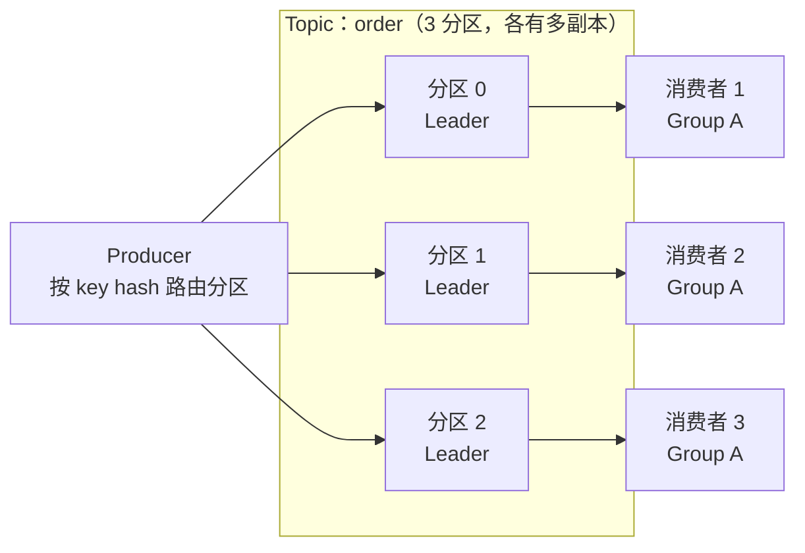

# Kafka 基础与架构

## Kafka 是什么？核心概念有哪些？

分布式**分区提交日志**（distributed commit log）：消息顺序追加到磁盘日志，消费靠 offset 拉取，天生支撑高吞吐发布订阅。

| 概念 | 说明 |
|------|------|
| **Broker** | 一个 Kafka 服务节点；多个 Broker 组成集群 |
| **Topic** | 逻辑分类（如"订单事件"），生产消费都面向 topic |
| **Partition** | topic 的物理分片，**最小并行与顺序单位**；一个分区只属于一个 Broker |
| **Replica** | 分区副本：1 个 Leader + N 个 Follower，Leader 读写、Follower 同步 |
| **Offset** | 每条消息在分区内的单调递增序号 |
| **Producer** | 生产者，按分区策略写入某分区 |
| **Consumer / Consumer Group** | 消费者/消费者组；**组内分区独占，组间互不影响（广播）** |

- 每条消息只落在**一个分区**；topic 整体无序，**分区内有序**
- 消费者组内：一个分区同一时刻只被一个消费者消费（负载均衡）
- 不同消费者组：各自独立消费全量消息（发布订阅）

## Kafka 为什么这么快？

| 手段 | 说明 |
|------|------|
| **顺序写磁盘** | 追加写 log 文件，磁盘顺序写 ≈ 内存随机写（百 MB/s） |
| **页缓存 PageCache** | 读写都走 OS 页缓存，热数据基本不落盘；重启缓存还在 |
| **零拷贝 sendfile** | 消费时数据从页缓存直达网卡，跳过用户态拷贝 |
| 批量 + 压缩 | producer 攒批（linger.ms + batch.size）发送，可整批压缩 |
| 分区并行 | 吞吐 = 单分区速度 × 分区数，水平扩展 |

## 分区数怎么定？越多越好吗？

- 经验起点：目标吞吐 ÷ 单分区吞吐（producer 单分区约 几十 MB/s），再留余量；通常 3~10 倍消费并行度
- 不是越多越好：
  - 每分区对应文件句柄、索引与 leader 副本分布，**越多 controller 故障转移越慢、选举越久**
  - 提升的是**并行上限**，单条消息延迟不变
  - leader 均衡周期变长，容易倾斜

**副本数**：生产常用 3（1 Leader + 2 Follower），兼顾可用性与成本。

## Kafka 的消息模型？

| 模型 | 实现 |
|------|------|
| 点对点（队列） | 一个消费者组消费，组内分摊 |
| 发布订阅（广播） | N 个消费者组各自消费全量 |

对比 RocketMQ：RocketMQ 广播靠 consumer 实例配置，Kafka 用"组"天然表达；Kafka 无延迟消息（RocketMQ 有），无 Tag 过滤（RocketMQ 有 Tag + SQL 过滤）。
