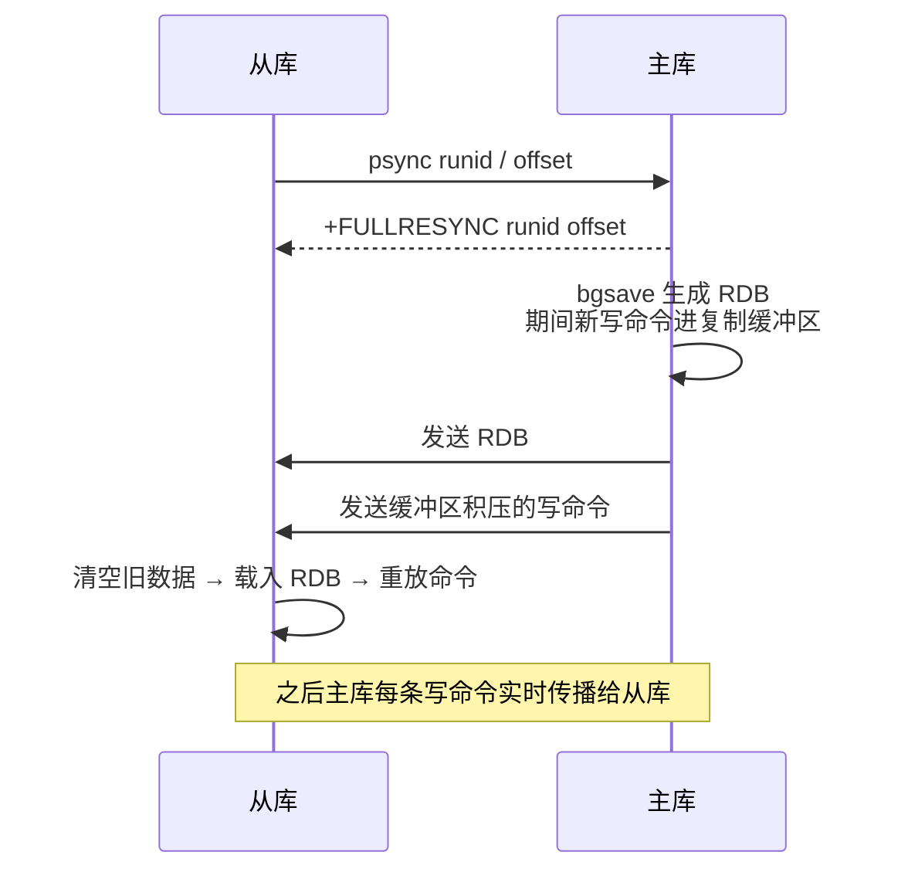

# Redis 主从与集群


## 主从复制的原理？

从库执行 `replicaof` 后，首次**全量同步**，断线重连时尝试**增量同步**：



| 机制 | 说明 |
|------|------|
| 全量同步 | 首次 / runid 变了 / offset 不在 backlog 内 |
| 增量同步 | 断线时间短，offset 之后的数据仍在**复制积压缓冲区**（repl_backlog，默认 1MB，可调大） |
| 命令传播 | 常态：主库每个写命令实时发给从库；从库默认**只读** |

## 哨兵（Sentinel）的作用？

主从不会自动切换，哨兵解决**故障自动转移**：监控、通知、自动故障转移、配置提供者。

### 故障转移流程

```
1. 每个哨兵定期 ping 主库，超时 → 标记 主观下线（sdown）
2. 达到 quorum 个哨兵都认为下线 → 客观下线（odown）
3. 哨兵间投票选出 leader 哨兵执行转移
4. 挑选新主：replica-priority 小的 → 复制 offset 最大的 → runid 最小
5. 其余从库改挂到新主，旧主恢复后降级为从
```

- 客户端连接哨兵获取当前主库地址；切换后哨兵发布 `switch-master` 事件
- 哨兵至少 3 个奇数个（含 1 个也能工作，但无容错）

### 脑裂

主库与哨兵、从库网络分区，哨兵提升了从库为新主，**旧主还在接收写入** → 分区恢复后旧主被降级、这批写入丢失。

缓解（限制旧主写入）：

```ini
min-replicas-to-write 1     # 至少 1 个从库连着我才允许写
min-replicas-max-lag 10     # 从库延迟超过 10s 视为不可用
```

代价：极端情况下牺牲可用性保数据。

## 集群（Cluster）的原理？

数据分片 + 去中心化，每个节点通过 **Gossip 协议**互相通信。

| 概念 | 说明 |
|------|------|
| 槽 | 全量 key 空间分为 **16384 个槽**，`slot = CRC16(key) % 16384`，每个主节点负责一段 |
| hash tag | `{user1000}.orders` 大括号内容相同 → 同一槽，多 key 操作才可用 |
| 主从 | 每个主可挂从，主挂后从自动顶上（内部自带故障转移，不再需要哨兵） |
| MOVED | 槽已归别的节点管，客户端收到后**更新本地槽表**，重定向 |
| ASK | 槽正在迁移中，本次去目标节点看看（不更新槽表） |
| 节点数 | 官方建议 ≤ 1000 主节点 |

### 为什么是 16384 个槽？

CRC16 产生 16 位（65536），若全用：节点心跳包要携带槽位 bitmap，65536/8 = 8KB 太大；16384 → 2KB，且 1000 节点内槽分布已足够均匀。

### Cluster 的限制

- 只有一个 db（db0）
- 多 key 命令 / 事务 / Lua 要求所有 key 同槽（hash tag）
- 客户端要支持集群协议（smart client 缓存槽表）

## 主从、哨兵、集群怎么选？

| 方案 | 解决 | 适用 |
|------|------|------|
| 主从复制 | 读扩展、数据热备 | 读多写少、单机容量够 |
| 主从 + 哨兵 | + 自动故障转移 | **大多数场景**，容量单机放得下 |
| Cluster | + 水平扩容 + 内置高可用 | 数据量/写入量超单机（内存 > 25GB 左右考虑） |
